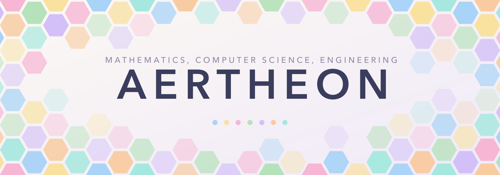
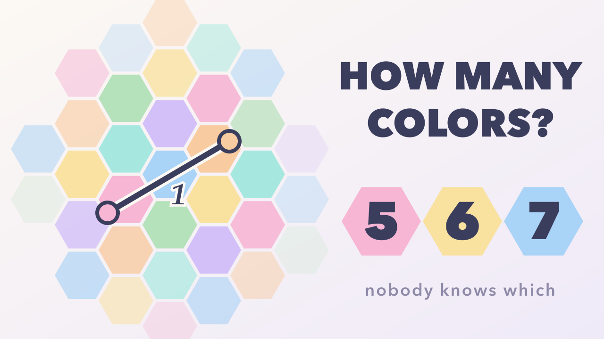
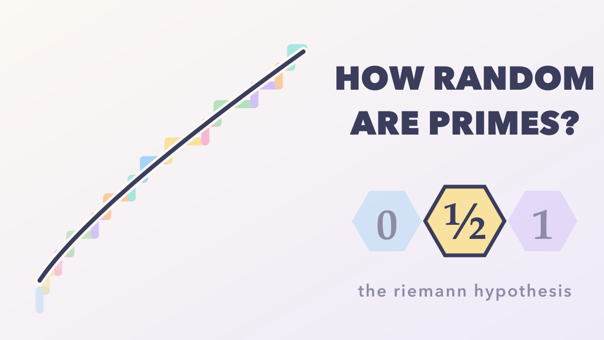
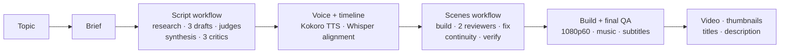

<p align="center">
  
</p>

<h1 align="center">AERTHEON engine</h1>

<p align="center">
  <b>Calm, beautiful explainer videos on mathematics, computer science and engineering, from one sentence.</b><br>
  Built with <a href="https://claude.com/claude-code">Claude Code</a>, <a href="https://www.manim.community/">Manim Community</a> and local <a href="https://huggingface.co/hexgrad/Kokoro-82M">Kokoro</a> TTS.
</p>

---

AERTHEON makes educational videos on mathematics, computer science and engineering. Every idea is built up from simple
examples and explained step by step, so anyone can follow along, no background needed.

This repository is the engine behind those videos, published as a **reference engine**: take it, run it, and make
similar videos of your own, whether for tutoring, for a university course or simply as a hobby. You name a topic, and
Claude researches it, writes and reviews the script, voices it, animates every scene, checks that picture and voice stay
in sync, and hands you a finished video.

```
> Make a 10 minute video about the Monty Hall problem.
```

## What you get

For every video, in its own folder:

| | |
|---|---|
| 🎬 **The video** | 1080p60, narrated, with a soft ambient music bed, mastered to −16 LUFS |
| 🖼️ **Three thumbnails** | 1280×720, pastel style, three different concepts to choose from or A/B test |
| 📝 **`youtube.md`** | three title options and a ready-to-paste description with chapters, sources and hashtags |
| 💬 **Extras** | subtitles (`.srt`), a 720p share copy, a waveform overview and the full QA reports |

## Examples

`reference/` holds the complete source of two finished videos (scripts, research, reviews, every scene, thumbnails).
They are the style reference the agents follow.

<table>
  <tr>
    <td width="50%"></td>
    <td width="50%"></td>
  </tr>
  <tr>
    <td><b>Five, Six, or Seven? The Hadwiger–Nelson Problem</b><br>How many colours does it take to paint the plane? The pilot and gold standard, 9:41, 11 scenes.</td>
    <td><b>Half the Digits: The Riemann Hypothesis</b><br>Primes, the zeta function and a million-dollar question, 9:40, 11 scenes.</td>
  </tr>
</table>

## Who it is for

- **Tutors and teachers**: a short, exact visual explanation of the one idea your students keep tripping over.
- **Universities**: lecture companions, course trailers and outreach videos in a consistent house style.
- **Hobbyists and creators**: start your own explainer channel, or just finally see that proof you always liked animated.

The style is aimed at curious non-experts: a smart 16-year-old, or an adult who left maths behind. Topics can come from
mathematics, computer science or engineering. Change the audience and tone in `STYLE.md` if yours is different.

## Quick start

**Requirements**
- macOS on **Apple silicon**: the narration runs Kokoro through `mlx-audio`, and the fonts (Avenir Next, Palatino) ship
  with macOS.
- [Claude Code](https://claude.com/claude-code), with workflows (multi-agent orchestration) available.
- Homebrew tools: `brew install uv ffmpeg librsvg pkgconf cairo pango`

**Setup**
```bash
git clone https://github.com/ULDAGON/aertheon.git
cd aertheon
./setup.sh      # creates .venv (Manim) and tts/.venv (Kokoro + Whisper); models download on first use
```

**Make a video**: open Claude Code in this folder and ask for one, at any length:
```
> Make a 10 minute video about how public-key cryptography works.
> Make a 2 minute short about why the sky is blue.
```

Videos are written **outside** the engine, to `../videos/<slug>/` (set `AERTHEON_VIDEOS=/some/path` to change it):

```
videos/<slug>/
├── <name>.mp4      the video
├── thumbnails/     three PNGs
├── youtube.md      three titles + description
└── src/            script, research, audio, timeline, scenes, tools, QA output
```

**Time and cost.** A 10-minute video takes about 2¾ hours and roughly $130 of model usage (about 80 agents). Short videos
still take about 2 hours, because every research and review stage still runs.

**More skills**
- `aertheon-scene`: fix or rework one scene ("the zoom in scene 4 is too fast"), then rebuild.
- `aertheon-thumbnail`: make or redo the three thumbnails, or regenerate the channel art.

## How it works



- **Audio is the master clock.** Every sentence is voiced separately with natural pauses and aligned word by word. Each
  scene renders silent and frame-exact against that timeline; sound is muxed once at the end. The picture changes exactly
  when the voice says so, and nothing animates in silence.
- **QA is built in.** Every scene render produces a report plus images: the waveform against picture motion, a frame at each
  narration cue, a contact sheet. The final build checks the whole video again (no voice gap > 1.6 s, every sentence
  audible, streams the same length).
- **Many agents, one style.** The script comes from three competing drafts, two judges, a synthesis and three critics (facts,
  clarity, pacing). Each scene is built by one agent, reviewed for teaching and for technique, fixed, and checked for
  continuity across the whole video.
- **Faithful content.** Shared geometry and numerics live in one `topic.py` that asserts its own claims, so what is on
  screen is computed, not drawn from memory.

## Repository layout

| Path | What it is |
|---|---|
| `AGENTS.md` | Rules for the agent (Claude Code reads it through `CLAUDE.md`) |
| `PIPELINE.md` | The ten steps, with commands and completion criteria |
| `STYLE.md` | Audience, tone, story arc, picture and sound |
| `SCRIPT_FORMAT.md` | The `script.json` format the script agents write |
| `THUMBNAIL.md`, `YOUTUBE.md` | Thumbnails, titles and description |
| `template/` | What every new video starts from: `common.py`, `TimedScene`, tools, `build.sh`, scene guide |
| `.claude/skills/`, `.claude/workflows/` | The entry points and the two multi-agent workflows |
| `branding/` | Brand tokens, channel banner, profile picture and this README's header |
| `reference/` | Full source of the two finished videos |
| `setup.sh`, `requirements-*.txt` | The two shared Python environments |

## Make it your own

The style is fixed on purpose, so that every video looks like a sibling of the others. To build your own channel or
course on the engine, change it once, deliberately:

- **Palette and fonts**: `template/common.py` (video) and `branding/brand.py` (thumbnails, channel art).
- **Voice and pacing**: `STYLE.md` and `template/tools/timeline.py` (Kokoro voice `af_heart` at speed 0.85 by default).
- **Audience, tone and story arc**: `STYLE.md`.
- **Channel name and the "About" paragraph**: `YOUTUBE.md` and `template/youtube.md`.
- **Channel art**: `branding/make_branding.py`, then `python3 make_branding.py`.

## Acknowledgements

- [3Blue1Brown](https://www.3blue1brown.com/), whose videos set the bar this style aims for, and the
  [Manim Community](https://www.manim.community/) that maintains the animation library.
- [Kokoro](https://huggingface.co/hexgrad/Kokoro-82M) and [mlx-audio](https://github.com/Blaizzy/mlx-audio) for the voice,
  and [faster-whisper](https://github.com/SYSTRAN/faster-whisper) for the word alignment.
- [Claude Code](https://claude.com/claude-code), which runs the whole pipeline.

## License

The code and docs are [MIT](LICENSE): use them for your own videos, courses or channel. The AERTHEON name, logo and
channel art images in `branding/` are not covered; please give your channel its own name and look
(see [Make it your own](#make-it-your-own)).
